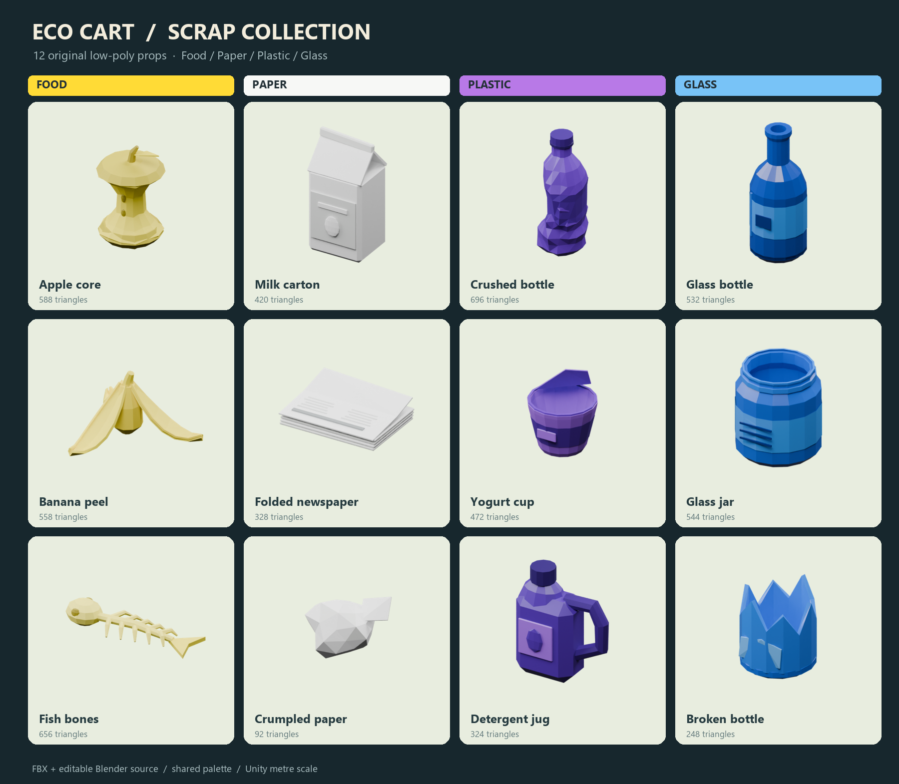

# Original scrap collection

Twelve original stylized low-poly props matching the four values in `ScrapType`: Food, Paper, Plastic, Glass. Created for Eco Cart with no external meshes or textures. Colours and silhouettes are intended to read from the game's overhead camera.

| Category | Models | Source triangle counts |
|---|---|---|
| Food | Apple core, banana peel, fish bones | 588 / 558 / 656 |
| Paper | Milk carton, folded newspaper, crumpled paper | 420 / 328 / 92 |
| Plastic | Crushed bottle, yogurt cup, detergent jug | 696 / 472 / 324 |
| Glass | Glass bottle, glass jar, broken bottle | 532 / 544 / 248 |

All surfaces now use category colours: **yellow food, white paper, purple plastic, blue glass**. Labels and small details use lighter/darker shades of the same category colour. Shapes and geometry are unchanged. Red is reserved for a possible future Metal type; this collection contains the four existing types. Historical GreenBottle/AmberJar asset filenames are retained for stable references.

## Assets

- Unity art prefabs: `Assets/Eco/Data/Prefabs/ScrapArt/<Category>/`.
- FBX models and manifest: `Assets/Eco/Data/Models/OriginalScrap/`.
- Materials: `Assets/Eco/Data/Models/OriginalScrap/Materials/`.
- Editable source: `Tools/ScrapArt/OriginalScrap.blend` (palette packed into the file).
- Deterministic Blender generator: `Tools/ScrapArt/build_scrap.py`.
- Review sheet generator: `Tools/ScrapArt/contact_sheet.py` (Pillow).

Each prefab has one mesh renderer, one submesh/material, and one simple box collider using the existing ScrapPM physics material. The four category materials share a 256×128 palette texture and use `Eco/Curved World/Lit`, with instancing enabled. Glass is opaque stylized glass; its low roughness, thick lips and inner walls provide the glass cues without transparent sorting. The longest dimensions range from 0.68 to 1.20 Unity metres, with centred pivots and Y-up FBX import. Models are static, unrigged, and have no animation. Palette UVs are per-face swatch coordinates, not a conventional paint unwrap.

These are **visual art prefabs**, without `ScrapItem`, a Rigidbody, pool IDs or effects. Existing collectible prefabs, world spawn lists, scene contents, balance and saved prefab IDs are untouched. To use the art on an existing collectible, replace its mesh child in Prefab Mode, retain the root ScrapItem/Rigidbody/effect references and pool ID, and choose either its existing collider or the supplied art collider to avoid duplicate collision shapes. New collectible variants still need the game's normal category, pool-ID, localization and world-list setup.

## Rebuild

1. Run Blender 5.2 in background mode with `--factory-startup --python Tools/ScrapArt/build_scrap.py` from the project root. This exports FBX files, palette, manifest, editable source and twelve rendered PNGs.
2. Let Unity import the output. Choose **Eco → Art → Rebuild Original Scrap Prefabs**, or run `unity command script eval --code "Eco.Scripts.EditorTools.OriginalScrapArtBuilder.Build();"`.
3. Run `python Tools/ScrapArt/contact_sheet.py` in a Python environment with Pillow to update the labelled review sheet.

Rebuild replaces this generated pack's art/material/prefab contents. Make separately named copies before customizing generated prefabs. The builder authors assets in an isolated preview scene and saves only the specific assets it changes.

## Verification

Imported and rendered all 12 prefabs in Unity 6000.5.2f1. Validated one renderer/submesh/material per prefab, nonzero correctly scaled bounds, category coverage, collider presence, texture assignment and successful compilation. Unity can discard degenerate FBX triangles, so some imported triangle counts are slightly below the source values shown above. The exact Unity import report is generated at `Logs/ScrapArt/unity-validation.txt` (ignored by Git). The review sheet is a Blender studio render; in-game lighting will differ. This asset-only addition does not change runtime performance or world spawning; no gameplay stress test was needed.
